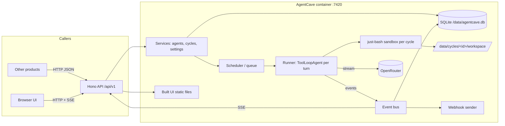
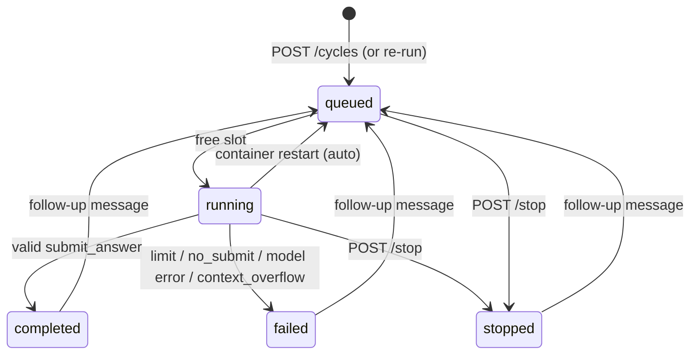

# AgentCave — Implementation Plan

> A small, self-contained Docker container. You create **agents** (a Markdown system prompt + an OpenRouter model + settings).
> Other products call its **HTTP API** to start an **agent cycle** (prompt + files). Each cycle runs in its own **bash sandbox**
> (just-bash). Callers can poll it, stream it, stop it, send follow-ups and download the result and files.
> A built-in web UI lets you manage agents, test them, and watch every cycle live: thinking, answer text and tool calls,
> shown one paragraph at a time.

Status: **implemented (M0–M6).** See "Implementation notes" at the end for the small differences from this plan.

---

## 1. Decisions from the brainstorm

| Topic | Decision |
|---|---|
| Language / runtime | TypeScript, Node.js 24 LTS, ESM |
| Database | SQLite, local file (Node's built-in `node:sqlite`, so nothing native to compile) |
| Ports | **One port** for UI + API. Default **7420** (`PORT` env var) |
| Security | **None built in.** Whoever deploys it puts their own proxy/VPN/firewall in front |
| OpenRouter token | Set **only in the Settings page** (stored in SQLite) |
| Files in | Sent **inside the JSON**: `{ path, content, encoding: "utf8" \| "base64" }` |
| Files out | New/changed files are **kept and downloadable** (one by one or as a zip), and visible in the UI |
| Internet in sandbox | **Per agent:** `none` / `allowlist` (URL prefixes) / `full` |
| JS / Python in sandbox | **Per-agent toggles** (just-bash `js-exec`, `python3`) |
| Parallel cycles | **Limit + waiting line** (default 4, set in Settings) |
| Getting results | Polling (always) + **webhook** + **live stream (SSE)** |
| Safety caps | **Max time, max money, max tokens** (no user-facing step cap; hidden hard cap of 500 steps) |
| History | **Auto-delete after X days** (Settings; 0 = keep forever) + manual delete |
| Reasoning | **Effort level**: `off / minimal / low / medium / high` |
| Per-call overrides | **Yes, all of them**: model, reasoning, limits, answer schema |
| Agent storage | **SQLite + import/export** as `.md` (front matter + prompt) |
| Agent versions | **Full version history**. Each cycle remembers the version it used. Roll back is possible |
| Final answer | A **`submit_answer` tool**. If the agent stops without calling it, AgentCave sends a user message telling it to call `submit_answer`, then continues |
| Restart behaviour | Cycles that were running are **restarted automatically** on boot |
| UI | **React + Vite**, **dark** theme, **CodeMirror** Markdown editor + live preview, **compact tool cards** |
| API docs | **Docs page in the UI** + `openapi.json` + README |
| Extras | Follow-up messages, agent's own files, JSON answers, cost & token counter, re-run button, labels on cycles, sub-agents |
| Sub-agents | **Allowlist per agent**. The sub-agent gets a **copy of the whole workspace**. Its changed files come back under `/workspace/.subagents/<slug>-<n>/` |
| Long contexts | **Shorten old tool outputs**. Every single tool output is capped at 30 KB |
| JSON answers | An agent can have a **default answer schema**. A caller can override it per cycle |
| Tests | **Core tests with a fake model** ($0) + one optional real OpenRouter smoke test |
| Git / CI | **Git + GitHub Actions**: test, then build and publish a multi-arch image to GHCR |
| Client library | **Yes**, a small zero-dependency TypeScript client in the repo |

### Words used in this document
- **Agent**: a saved, versioned config: Markdown system prompt, model, reasoning, internet mode, JS/Python toggles, default limits, allowed sub-agents, default answer schema, own files.
- **Cycle**: one agentic run started by a caller (API or UI). It has one sandbox and one or more **turns**.
- **Turn**: one prompt, then work, then `submit_answer`. The first prompt is turn 0, and each follow-up adds a turn.
- **Step**: one model call inside a turn. It may produce thinking, text and tool calls.

---

## 2. Tech stack (checked on 2026-10-11)

| Part | Choice | Why |
|---|---|---|
| HTTP server | `hono` 4 + `@hono/node-server` | Tiny, fast, has SSE helpers and an OpenAPI (zod) integration |
| Validation / OpenAPI | `zod` 4 + `@hono/zod-openapi` | One schema gives runtime validation, TypeScript types and `openapi.json` |
| Database | `node:sqlite` (`DatabaseSync`), WAL mode, plain SQL migrations | No native build, smallest image. The experimental warning is silenced with `--disable-warning=ExperimentalWarning` |
| Agent loop | `ai` **7.x** (`ToolLoopAgent`, `stopWhen`, `prepareStep`, `fullStream`) | Required by you; current major |
| Model provider | `@openrouter/ai-sdk-provider` **3.x** (needs `ai@^7`, Node ≥ 22) | Official OpenRouter provider. Reports cost through usage accounting |
| Sandbox | `just-bash` **3.x** + `bash-tool` **1.x** | Required by you. `bash-tool` gives the `bash` / `readFile` / `writeFile` tools and before/after hooks |
| JSON-Schema validation | `ajv` | Checks caller-supplied answer schemas and validates `submit_answer` input |
| Web UI | React 19, Vite, React Router, TanStack Query, Tailwind CSS 4 | Common, well supported |
| Editor | CodeMirror 6 (`@uiw/react-codemirror`, markdown + json langs) | Markdown prompt editor and JSON schema editor |
| Markdown render | `react-markdown` + `remark-gfm` + a light highlighter (`highlight.js` core, a few languages) | Renders answer and thinking paragraphs |
| Tests | Vitest + the mock language model from `ai/test` | Deterministic, costs $0 |
| Lint/format | Biome | One small tool instead of ESLint + Prettier |

> **Compatibility check at the start of M0:** `bash-tool` depends on `zod@^3` while the rest uses `zod@4`. If that causes type
> or runtime problems, we write the three tools directly on just-bash instead (about 100 lines) and keep the same behaviour.

---

## 3. Architecture



Everything is **one Node process**: API, scheduler, runners, webhook sender and the retention job. SQLite is the source of truth.
An in-process event bus pushes live events to SSE listeners and to the webhook sender.

### Data directory (`/data`, a Docker volume)

```
/data/
  agentcave.db                       SQLite (WAL)
  blobs/ab/abcdef…                   content-addressed file store (sha256); input files, agent files, snapshots
  agents/<versionId>/                agent's own files, written out once per version (mounted read-only)
  cycles/<cycleId>/workspace/        the cycle's live sandbox files (mounted read-write at /workspace)
```

The **blob store** removes duplicates. Input files, agent files and per-turn workspace snapshots are stored as
**manifests** (path → sha256) in SQLite that point into `blobs/`. Snapshots are therefore cheap, and the
"changed files" list is a simple manifest comparison.

---

## 4. Database schema (first migration)

```sql
settings(key TEXT PRIMARY KEY, value TEXT NOT NULL)          -- JSON values
  -- openrouter_token, max_parallel(4), retention_days(30), default_limits{maxTimeSec:900,maxCostUsd:1,maxTokens:2000000},
  -- hard_step_cap(500), max_nudges(3), subagent_max_depth(3), tool_output_cap_bytes(30720),
  -- context_trim_ratio(0.6), max_request_mb(50), webhook_secret(null)

agents(id TEXT PK, slug TEXT UNIQUE, name TEXT, description TEXT,
       current_version INTEGER, archived INTEGER DEFAULT 0, created_at, updated_at)

agent_versions(id TEXT PK, agent_id TEXT, version INTEGER, note TEXT,
       system_prompt TEXT,                 -- Markdown
       model TEXT, reasoning TEXT,         -- 'off'|'minimal'|'low'|'medium'|'high'
       internet_mode TEXT, internet_allowlist TEXT,   -- 'none'|'allowlist'|'full', JSON array of URL prefixes
       allow_js INTEGER, allow_python INTEGER,
       default_limits TEXT,                -- JSON {maxTimeSec?, maxCostUsd?, maxTokens?}
       output_schema TEXT,                 -- JSON Schema or NULL (NULL = plain Markdown answer)
       subagents TEXT,                     -- JSON array of agent slugs
       created_at, UNIQUE(agent_id, version))

agent_version_files(version_id TEXT, path TEXT, sha256 TEXT, size INTEGER, PRIMARY KEY(version_id, path))

blobs(sha256 TEXT PK, size INTEGER, refcount INTEGER)     -- data lives on disk

cycles(id TEXT PK,                         -- 'cyc_' + ULID (sortable)
       agent_id, agent_version_id,
       parent_cycle_id, root_cycle_id, depth INTEGER,       -- sub-agents
       source TEXT,                        -- 'api'|'ui'|'subagent'|'rerun'
       rerun_of TEXT,
       status TEXT,                        -- see lifecycle
       model, reasoning, limits TEXT, output_schema TEXT,   -- effective values after overrides
       labels TEXT,                        -- JSON object of string→string
       webhook_url TEXT,
       error_code TEXT, error_message TEXT,
       input_tokens, output_tokens, reasoning_tokens, cached_tokens, cost_usd REAL, steps INTEGER,
       attempts INTEGER DEFAULT 0,         -- times restarted after a crash
       current_activity TEXT,              -- short "running bash: grep -rn TODO" for polling
       created_at, started_at, finished_at, updated_at)

turns(id TEXT PK, cycle_id, idx INTEGER, prompt TEXT,
      input_manifest TEXT,                 -- files added by this turn
      start_snapshot TEXT,                 -- workspace manifest at turn start (for restart + diff)
      end_snapshot TEXT,
      messages TEXT,                       -- AI SDK ModelMessage[] produced in this turn (full, untrimmed)
      answer TEXT,                         -- JSON
      status, nudges INTEGER, usage..., started_at, finished_at)

events(seq INTEGER PK AUTOINCREMENT, cycle_id, turn_idx, attempt, type TEXT, data TEXT, ts)
  -- index (cycle_id, seq). Paragraph-level, not token-level, so the table stays small.

webhook_deliveries(id PK, cycle_id, event, url, attempt, status_code, error, next_retry_at, created_at)
```

Indexes: `cycles(status)`, `cycles(agent_id, created_at)`, `cycles(root_cycle_id)`, plus a JSON-label lookup via
`json_each(labels)` (fine at this scale).

---

## 5. The sandbox

One just-bash `Bash` instance is created per turn, on top of a `MountableFs`:

| Mount | Filesystem | Content |
|---|---|---|
| `/` (base) | `InMemoryFs` | scratch space; `/tmp` lives here and is thrown away |
| `/workspace` | `ReadWriteFs({ root: /data/cycles/<id>/workspace })` | caller's files + everything the agent writes. **cwd** |
| `/agent` | `OverlayFs({ root: /data/agents/<versionId>, readOnly: true })` | the agent's own reference files (read-only) |

- **Internet:** `none` means no `network` option, so `curl` doesn't exist. `allowlist` means `network.allowedUrlPrefixes` = the agent's list, methods GET/HEAD/POST.
  `full` means `dangerouslyAllowFullInternetAccess: true`. The UI shows a warning that "full" can also reach your internal network.
- **JS / Python:** `javascript: true` and `python: true` only when the agent's toggle is on.
- **Limits:** just-bash `executionLimits` (for example `maxExecutionTimeMs` 30 s per command, `maxFileSystemBytes`), plus the
  cycle's AbortSignal passed to every `exec` so Stop works right away.
- **Path safety:** input paths are normalised. Absolute paths, `..`, NUL characters and duplicates are rejected with 400.
- **Container hardening:** runs as a non-root user, and only `/data` is writable. just-bash is not a VM, so the container is the real boundary.

### Tools the model sees

| Tool | Notes |
|---|---|
| `bash` | from bash-tool. Output over **30 KB** is cut to head + tail, and the full text is saved to `/tmp/agentcave/out-<n>.txt` so the agent can `grep` it |
| `readFile`, `writeFile` | from bash-tool |
| `submit_answer` | input schema = effective answer schema. Default: `{ answer: string /* Markdown */ }`. Validated with Ajv. Invalid input goes back to the model as a tool error, and the loop continues |
| `ask_<slug>` | one per allowed sub-agent: `{ prompt: string }` (see §7) |

### System prompt actually sent
`agent.system_prompt` (your Markdown) **+** a short AgentCave "environment" section that AgentCave generates:
where the files are, `/agent` reference files, internet mode, available languages, available sub-agents, and
"when you are done, call `submit_answer`". The UI shows this **exact final text** in the collapsed "System prompt" card.

---

## 6. The agent loop (one turn)

```
runTurn(cycle, turn):
  snapshot = manifest(workspace)                        # saved as turn.start_snapshot
  sandbox  = createSandbox(cycle)                       # §5
  agent = new ToolLoopAgent({
    model: openrouter(model, { usage: { include: true } }),
    instructions: finalSystemPrompt,
    tools: { bash, readFile, writeFile, submit_answer, ...subagentTools },
    providerOptions: { openrouter: { reasoning: effort === 'off' ? { enabled: false } : { effort } } },
    stopWhen: [ submittedValidAnswer, isStepCount(hardStepCap), budgetExceeded ],
    prepareStep: trimOldToolOutputs,                    # §6.3
  })
  messages = history(previous turns) + userMessage(prompt + list of new files)
  loop:
    stream = agent.stream({ messages, abortSignal })    # abort = Stop button, time limit, money/token limit, parent stop
    pipe stream.fullStream → event pipeline (§8)
    messages += response messages
    if valid submit_answer → turn.answer = input → done
    if nudges < max_nudges(3):
       messages += user("You stopped without calling `submit_answer`. To finish, call the `submit_answer` tool with your final answer.")
       emit 'nudge' event; continue
    else fail(code: 'no_submit')
  end_snapshot = manifest(workspace); compute changed files; fire webhook
```

### 6.1 Limits
- **Time:** an `AbortController` with a timer (`maxTimeSec`). It covers the whole turn, sub-agents included.
- **Money:** after every step, add up `providerMetadata.openrouter.usage.cost`. If the provider leaves it out, fall back to
  model pricing × tokens. When the total goes over `maxCostUsd`, abort. *It can go slightly over, by at most one step.*
- **Tokens:** the same check on `inputTokens + outputTokens` (reasoning included).
- Limits apply **per turn** (a follow-up gets a fresh budget). The cycle also shows its totals.
- Sub-agent spending counts toward the **parent's** turn budget (one shared budget object for the whole tree).
- Hitting a limit gives status `failed` with `error.code` = `limit_time` | `limit_money` | `limit_tokens` | `limit_steps`.

### 6.2 Answers
- Default: `answer = { format: "markdown", text }`.
- With a schema (agent default or caller override): `answer = { format: "json", data }`, already validated.
- Every finished turn also reports `files: { added[], modified[], deleted[] }` (relative to the turn's start).

### 6.3 Shortening old tool outputs (long cycles)
In `prepareStep`, estimate the prompt size (characters ÷ 4). When it goes over `context_trim_ratio` (60%) of the model's
`context_length` (from the model catalog), replace the outputs of **all but the last 6 tool results** with a ~500-character preview plus
`[output shortened by AgentCave]`. Trimming happens in **batches** (only when the line is crossed), so prompt caching still
works between trims. Full outputs stay in the database and the UI. Only what is sent to the model is shortened.
If the context still overflows, the cycle fails with `context_overflow`.

### 6.4 Restart after a crash or redeploy
On boot, every cycle with status `running` is reset to `queued` and `attempts++`. When it runs again, the interrupted turn's
workspace is **restored from `start_snapshot`**, that turn's messages are thrown away, and the turn starts over (events
get an `attempt` number, and the UI shows a "restarted after container restart" divider). Sub-cycles of an interrupted turn are
marked `interrupted` (they will be created again). *Note: a restart spends tokens again.*

---

## 7. Sub-agents

- Agent settings have a checklist of other agents it may call. Each one becomes a tool `ask_<slug>({ prompt })`,
  described with the sub-agent's name and description.
- When called: create a **child cycle** (`parent_cycle_id`, `depth+1`, `source: 'subagent'`). Its workspace starts as a **copy
  of the parent's whole current workspace** (from a manifest, so it's cheap). It uses the sub-agent's own version, model and schema.
- Child cycles **don't go through the queue** (they use the parent's slot). Otherwise all slots could fill with parents
  waiting for children that can never start.
- When the child finishes, its new/changed files are copied into the parent at `/workspace/.subagents/<slug>-<n>/`
  (paths kept), and the tool result is `{ answer, filesCopiedTo, changed: [...] }`.
- Stopping the parent stops its children. Depth is capped by `subagent_max_depth` (3). Cost and tokens add up to the root.
- The UI shows a sub-agent card in the parent's timeline (live status, link to the child cycle). The child has its own full view.

---

## 8. Events and live streaming

### Paragraph chunker
`reasoning-delta` and `text-delta` pieces are buffered **per stream** and sent as a `reasoning` / `text` event when:
- a blank line (`\n\n`) ends a paragraph **outside a code block** (code blocks are sent whole), or
- the buffer goes over about 1500 characters, or
- 4 seconds pass without a paragraph break (so long paragraphs don't look stuck), or
- the part ends (`reasoning-end` / end of text).

Only these paragraph events are stored, never single tokens.

### Event types (stored in `events`, sent over SSE)
`cycle.status`, `turn.start`, `step.start`, `reasoning` (paragraph), `text` (paragraph), `tool.call`
(`{ id, name, input }`), `tool.result` (`{ id, output, exitCode, truncated, ms }`), `subagent.start` / `subagent.end`,
`nudge`, `trim`, `usage` (running totals after each step), `answer`, `error`, `turn.end`.
If a provider hides the thinking (encrypted reasoning), a `reasoning` event with `{ hidden: true, tokens }` is sent.

### SSE
`GET /api/v1/cycles/:id/events` first replays stored events from `?after=<seq>` (or the `Last-Event-ID` header), then sends live ones.
It sends a heartbeat comment every 15 s, and the stream closes after `cycle.status` reaches a final state. The same endpoint feeds the UI and outside programs.

---

## 9. Cycle lifecycle



Final states: `completed`, `failed`, `stopped`. A follow-up is only accepted when the cycle is in a final state (otherwise 409).

---

## 10. HTTP API (`/api/v1`, JSON, no auth)

### Agents
| Method | Path | Purpose |
|---|---|---|
| GET | `/agents` | list (with current version summary, cost totals) |
| POST | `/agents` | create (creates version 1) |
| GET | `/agents/:slug` | current version, full detail |
| PUT | `/agents/:slug` | save, which **creates a new version** (`note` optional). Omitted files are kept |
| DELETE | `/agents/:slug` | archive (old cycles keep working) |
| GET | `/agents/:slug/versions` · `/versions/:n` | history · one version |
| POST | `/agents/:slug/versions/:n/restore` | roll back (makes a new version copying `n`) |
| GET | `/agents/:slug/export` | `.md` (front matter + prompt), or `.zip` if the agent has files |
| POST | `/agents/import` | `.md` or `.zip` |

Export format:
```markdown
---
name: Code Reviewer
slug: code-reviewer
description: Reviews code and lists bugs
model: anthropic/claude-sonnet-5.5
reasoning: medium
internet: { mode: allowlist, urls: ["https://api.github.com/"] }
javascript: false
python: true
limits: { maxTimeSec: 900, maxCostUsd: 1.5, maxTokens: 2000000 }
subagents: [test-writer]
outputSchema: null
---
You are a meticulous code reviewer. …
```

### Models & settings
| Method | Path | Purpose |
|---|---|---|
| GET | `/models` | OpenRouter catalog (cached 1 h, refresh button). Only models that support `tools`. Fields: id, name, context, $/M in/out, `reasoning` support, image input support |
| GET / PUT | `/settings` | token is **masked** on GET |
| POST | `/settings/test-token` | calls OpenRouter's key-info endpoint, returns credit/limit |
| GET | `/stats?from&to&groupBy=agent\|model\|day` | cost & token dashboard |
| GET | `/health` | liveness + DB OK + queue size |
| GET | `/openapi.json` | spec |

### Cycles
| Method | Path | Purpose |
|---|---|---|
| POST | `/cycles` | start → **202** `{ id, status: "queued", links }` |
| GET | `/cycles` | list. Filters: `agent`, `status`, `label.<key>=<value>`, `parent`, `cursor`, `limit` |
| GET | `/cycles/:id` | **poll**: status, progress, usage, answer (when done), error |
| GET | `/cycles/:id/answer` | answer only (409 while running) |
| GET | `/cycles/:id/events` | SSE (or `?format=json&after=` for paged JSON) |
| POST | `/cycles/:id/stop` | stop (stops children too) |
| POST | `/cycles/:id/messages` | **follow-up** `{ prompt, files? }` → new turn |
| POST | `/cycles/:id/rerun` | new cycle with the same input. Optional `{ overrides, agentVersion }` |
| GET | `/cycles/:id/files?changed=true` | file list with `added/modified/deleted/unchanged` |
| GET | `/cycles/:id/files/*path` | download one file |
| GET | `/cycles/:id/files.zip?changed=true` | zip download |
| GET | `/cycles/:id/turns` | turns with prompts, answers and usage |
| DELETE | `/cycles/:id` | delete cycle + workspace (409 while running) |

Start a cycle:
```bash
curl -X POST http://localhost:7420/api/v1/cycles \
  -H 'content-type: application/json' \
  -d '{
    "agent": "code-reviewer",
    "prompt": "Review src/app.ts and list real bugs only.",
    "files": [
      { "path": "src/app.ts", "content": "export const x = 1;\n" },
      { "path": "logo.png", "content": "iVBORw0KGgo…", "encoding": "base64" }
    ],
    "overrides": { "model": "openai/gpt-5.2", "reasoning": "high", "limits": { "maxCostUsd": 0.5 } },
    "outputSchema": { "type": "object", "properties": { "bugs": { "type": "array", "items": { "type": "string" } } }, "required": ["bugs"] },
    "labels": { "customer": "123", "ticket": "ABC-9" },
    "webhookUrl": "https://example.com/agentcave-hook"
  }'
```

Poll response:
```json
{
  "id": "cyc_01JA…",
  "status": "running",
  "agent": { "slug": "code-reviewer", "version": 7 },
  "model": "openai/gpt-5.2", "reasoning": "high",
  "turn": 0,
  "progress": { "steps": 5, "activity": "running bash: grep -rn TODO src/", "lastParagraph": "I found three suspicious…" },
  "usage": { "inputTokens": 48211, "outputTokens": 2210, "reasoningTokens": 1800, "costUsd": 0.0412 },
  "limits": { "maxTimeSec": 900, "maxCostUsd": 0.5, "maxTokens": 2000000 },
  "answer": null,
  "files": null,
  "error": null,
  "labels": { "customer": "123", "ticket": "ABC-9" },
  "createdAt": "…", "startedAt": "…", "finishedAt": null
}
```

### Webhooks
A `POST` to `webhookUrl` on `turn.completed`, `cycle.completed`, `cycle.failed` and `cycle.stopped`. The body is the same as the poll response plus `event`.
If a webhook secret is set in Settings, AgentCave adds an `X-AgentCave-Signature: sha256=<hmac>` header (optional, so receivers can trust the call).
Failed calls are retried 5 times with backoff (10 s → 30 min). Deliveries are listed in the cycle's Details tab.

Request size limit: `max_request_mb` (default 50 MB, setting). Errors use one format: `{ error: { code, message, details? } }`.

---

## 11. Screens (UI)

Dark theme, left sidebar: **Cycles · Playground · Agents · Usage · API Docs · Settings**. Runs at `/`, served by the same Hono server.

1. **Cycles (home)**: live table: status chip (pulses while running), agent@version, model, labels, duration, tokens, $,
   source (API / UI / sub-agent). Filters by agent, status and label. Updates live from a small SSE "all cycles" feed.
2. **Cycle view (the main screen)**
   - Header: status, agent@version (link), model, reasoning, **live timer, token and $ counters with limit bars**, buttons:
     **Stop**, **Re-run** (opens overrides: model / reasoning / agent version), **Follow-up**, **Download files**.
   - Timeline (centre):
     - ▸ **System prompt** card, **collapsed** by default (the exact final text, rendered Markdown).
     - **User prompt** card with file chips.
     - 💭 **Thinking** paragraphs: dimmed, each block can be collapsed. They appear paragraph by paragraph.
     - 💬 **Answer text** paragraphs: rendered Markdown.
     - **Compact tool cards**: `$ command`, exit-code badge, duration, output folded (click to open, monospace, "shortened" badge).
     - **Sub-agent cards**: sub-agent name, live status, cost, "open" link, folded answer.
     - **Nudge** cards ("AgentCave reminded the agent to call submit_answer"), **trim** markers, **restart** dividers.
     - ✅ **Final answer** card: Markdown, or a JSON tree viewer, plus a changed-files summary.
     - Follow-up turns continue below with a turn divider.
   - Right panel tabs: **Files** (workspace tree with added / modified / deleted badges, preview for text and images, download),
     **Details** (effective limits, labels, webhook deliveries, per-step usage table), **Raw** (event JSON for debugging).
3. **Playground**: pick an agent, write a prompt, **drag and drop files or a folder**, optional overrides, answer schema and labels, then **Run**. It opens the
   cycle view. The agent editor's "Test" button opens this page with that agent already chosen.
4. **Agents**: list, then the editor:
   - Name, slug, description.
   - **Model picker**: searchable list from OpenRouter (price per 1M in/out, context size, "reasoning" and "image input" badges).
     The reasoning dropdown is disabled when the model doesn't support reasoning.
   - Reasoning effort, internet mode (+ URL list), JS / Python switches, default limits, sub-agent checklist,
     default answer schema (JSON editor with validation).
   - **Own files**: upload, delete, preview (mounted read-only at `/agent`).
   - **Prompt editor**: CodeMirror Markdown on the left, live preview on the right.
   - **Version history** drawer: list, diff between two versions, restore. Export / import buttons.
5. **Usage**: totals for cost and tokens by day / agent / model (small bar charts drawn with hand-written SVG, no chart library).
6. **API Docs**: endpoint list built from `openapi.json`, request/response examples, **copy-paste curl**, and an SSE example.
7. **Settings**: OpenRouter token (masked, **Test** button shows the credit left), max parallel cycles, retention days,
   default limits, hidden step cap, max nudges, sub-agent max depth, tool output cap, trim ratio, max request size,
   webhook secret (generate / clear).

---

## 12. Client library (`client/`, published as `@agentcave/client`)

No dependencies, uses `fetch`, works in Node 20+ and browsers. Types are shared with the server.
```ts
const cave = new AgentCave({ baseUrl: "http://agentcave:7420" });
const { id } = await cave.cycles.start({ agent: "code-reviewer", prompt, files });
for await (const ev of cave.cycles.events(id)) { /* paragraphs, tool calls… */ }
const done = await cave.cycles.wait(id, { pollMs: 2000, timeoutMs: 20 * 60_000 });
await cave.cycles.followUp(id, { prompt: "Now fix them." });
const zip = await cave.cycles.downloadZip(id, { changedOnly: true });
await cave.cycles.stop(id);
```

---

## 13. Repository layout (npm workspaces)

```
agentcave/
├─ package.json                 workspaces: shared, server, web, client
├─ biome.json  tsconfig.base.json
├─ Dockerfile  .dockerignore  docker-compose.example.yml
├─ .github/workflows/ci.yml     lint · typecheck · test · build
├─ .github/workflows/docker.yml multi-arch (amd64/arm64) image → ghcr.io/<owner>/agentcave
├─ PLAN.md  README.md
├─ shared/src/                  zod schemas + types (API DTOs, events, export format)
├─ server/
│  ├─ src/index.ts              boot: config → db+migrations → recovery → scheduler → retention → http
│  ├─ src/config.ts             PORT, HOST, DATA_DIR, LOG_LEVEL
│  ├─ src/db/                   sqlite.ts, migrations/*.sql, repos/*.ts
│  ├─ src/blobs.ts              content-addressed store + manifests + GC
│  ├─ src/openrouter/           provider factory, model catalog cache, key check
│  ├─ src/agents/               service, versions, import/export
│  ├─ src/sandbox/              workspace, mounts, snapshot/restore, diff
│  ├─ src/engine/               scheduler, runner, tools, submit, subagents, limits, trim, chunker, prompt, events bus
│  ├─ src/webhooks.ts  src/retention.ts
│  ├─ src/http/                 app, routes/*, sse, openapi, static UI + SPA fallback
│  └─ test/
├─ web/src/                     pages/, components/ (timeline, tool-card, model-picker, md-editor…), api/, lib/
└─ client/src/
```

---

## 14. Docker

- Multi-stage build on `node:24-alpine`: **build** (`npm ci`, build web with Vite, build server with `tsc`) → **runtime** (production
  dependencies only, `server/dist`, `web/dist`).
- Non-root user `cave`, `VOLUME /data`, `EXPOSE 7420`, `HEALTHCHECK` on `/api/v1/health`, `tini` as PID 1 for clean shutdown.
- `CMD ["node", "--disable-warning=ExperimentalWarning", "server/dist/index.js"]`.
- Env vars (few by design): `PORT=7420`, `HOST=0.0.0.0`, `DATA_DIR=/data`, `LOG_LEVEL=info`.
- **SIGTERM:** stop accepting cycles, abort running turns, and leave them `running` in the database so the next boot restarts them (§6.4).
- Target image size: about 200 MB or less. **To check in M0:** how much just-bash's Python adds. If it's very large, we still
  ship it (Python is a per-agent toggle you asked for) and write down the size.

```bash
docker run -d --name agentcave -p 7420:7420 -v agentcave-data:/data ghcr.io/<owner>/agentcave:latest
```

---

## 15. Testing

- **Unit:** paragraph chunker (code blocks, idle flush), path normalisation, manifest diff, trim logic, limit checks,
  JSON-schema handling, export/import round trip, migrations.
- **Engine (fake model from `ai/test`, $0):** a normal cycle → `submit_answer`; **forgot to submit → nudge → submit**;
  nudges used up → `no_submit`; invalid JSON answer → tool error → fixed; money / token / time limits; Stop during a bash command;
  sub-agent copy-in / copy-back and budget sharing; follow-up keeps memory and files; restart recovery restores the snapshot.
- **API:** Hono `app.request()` tests for every route, SSE replay with `after`, webhook retries (local test server), retention job.
- **Smoke (optional, needs `OPENROUTER_TOKEN_TEST`):** one tiny real cycle against a cheap model. CI skips it without the secret.

---

## 16. Build order (milestones)

| # | Milestone | Done when |
|---|---|---|
| M0 | Scaffold: git, workspaces, Biome, tsconfig, CI, Dockerfile skeleton. **Check compatibility** of ai 7 + bash-tool + just-bash + zod, and Python size | `docker build` works, CI is green |
| M1 | DB + migrations, settings, blob store, agents + versions + own files + import/export, model catalog | Agents can be created and versioned through the API |
| M2 | Sandbox (mounts, internet modes, JS/Python), tools, `submit_answer` + nudges, limits, cost, trimming, chunker, event bus, scheduler/queue, restart recovery | Engine tests pass with the fake model |
| M3 | Cycles API, SSE, follow-ups, re-run, files / zip, labels, webhooks, retention, OpenAPI | Start / poll / stream / stop / download works from curl |
| M4 | Sub-agents | Child cycles run, share the budget, and copy files back |
| M5 | UI: shell, Settings, Agent editor (CodeMirror, model picker, versions), Cycles list, **Cycle live view**, Playground, Usage, API Docs | Full flow works in the browser against a real model |
| M6 | Client library, README, image hardening, GHCR publishing, final pass | `docker run` → open UI → set token → create agent → run from the API |

---

## 17. Risks and notes

- **just-bash is not a VM.** The container is the real safety boundary. "Full internet" agents can reach anything the container can reach.
- **Money cap** is checked after each step, so it can go over by up to one step's cost.
- **Cost field:** some OpenRouter routes may not report `cost`. In that case we use catalog pricing × tokens and mark the cost "estimated".
- **Hidden thinking:** some models keep their thinking private or encrypted. The UI then shows "thinking (hidden), N tokens".
- **Weak tool use:** some models are bad at calling tools even if they claim support. Nudges help, and `no_submit` fails cleanly.
- **Restart re-runs spend money again.** The interrupted turn starts over from its snapshot.
- **No auth:** `GET /settings` hides the token, but anyone who can reach the port can use your OpenRouter credit. You said this is expected.
- **`node:sqlite`** still prints an "experimental" warning in Node 24 (silenced). Its API is stable enough for our simple use.

## 18. Ideas for later (not in v1 unless you want them)
- Show image input files to vision models directly (as image parts), not only as files in the sandbox.
- MCP servers as extra tools for an agent.
- Cron-style scheduled cycles.
- Compare view (same prompt on 2+ agents side by side). Re-run already covers part of this.

---

## Implementation notes (differences from the plan)

- **`/agent` mount is copy-on-write**, not strictly read-only. With a read-only overlay, just-bash aborts the *whole* command on a write attempt (losing the output of earlier commands in the same line). Now writes to `/agent` stay in memory and are thrown away, so the stored files never change either way.
- **Reasoning levels** also include `xhigh` (OpenRouter supports it): `off / minimal / low / medium / high / xhigh`.
- **Webhooks**: one event at the end of every turn — `cycle.completed | cycle.failed | cycle.stopped` with the turn index — instead of a separate `turn.completed`.
- **Sub-agent workspace copy** leaves out `/workspace/.subagents/` (so results of earlier sub-agents are not copied around again and again).
- **Demo mode** (`npm run demo`): a scripted fake model with two sample agents, to explore the UI without a token. Not in the plan; added for testing the UI.
- **Image size**: just-bash needs `sql.js` (its `sqlite3` command) and `typescript` (for `js-exec`), so the server's production dependencies are about 130 MB. The Dockerfile prunes source maps, docs and unused sql.js builds (→ ~105 MB), and the runtime stage is plain `alpine:3.24` plus the Node binary (no npm/yarn). Result: **~330 MB** as reported by Docker, of which the Node binary alone is 125 MB. Built and tested on 2026-10-12: healthy start, non-root, sandbox commands (`sqlite3`, `jq`, `js-exec`, `python3`, `xan`, `gzip`, `html-to-markdown`), a cycle reaching OpenRouter, graceful SIGTERM, data kept across restarts.
- **bash-tool** is used with a custom sandbox adapter. The adapter adds what bash-tool lacks: an instant Stop (AbortSignal on every command), saving long output to `/tmp/agentcave/`, and turning sandbox exceptions into `stderr` so the agent sees them.
